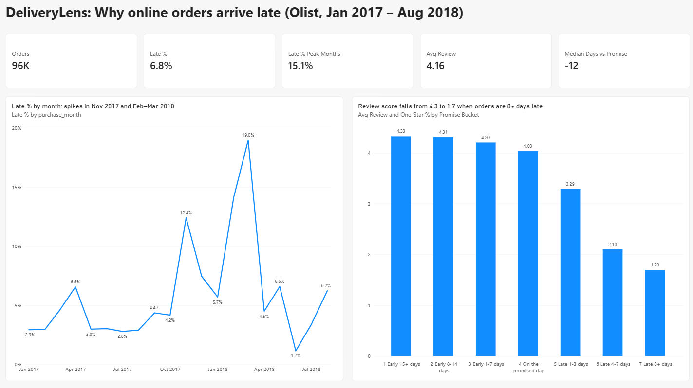
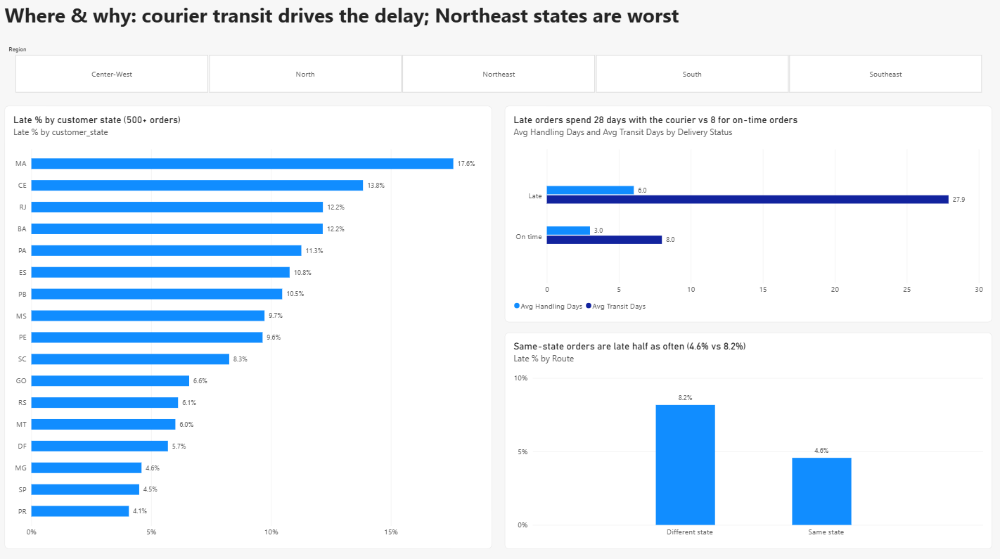
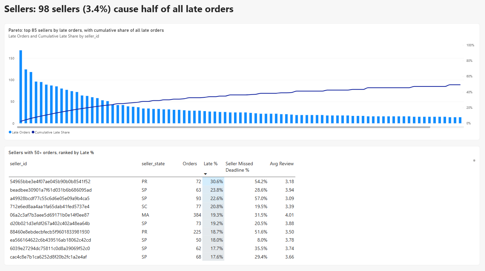

# 📦 DeliveryLens: Why Do Online Orders Arrive Late?

**Where does delivery delay come from (seller or courier, region or season), and what does it cost in customer ratings?**

A SQL Server + Power BI analysis of **96,018 delivered orders** from Olist, a Brazilian e-commerce marketplace (Jan 2017 – Aug 2018). All cleaning and analysis is in T-SQL (SSMS); the dashboard is built in Power BI on top of one SQL view.

---

## Key findings

| | Finding |
|---|---|
| **Late rate** | **6.8%** of orders (6,528) arrived after the promised date |
| **Cost in ratings** | Avg review falls from **4.33** (15+ days early) to **1.70** (8+ days late); 1-star share rises from **6.5%** to **69.8%** |
| **Peaks** | Late % jumps from ~3% to **12.4%** (Nov 2017, Black Friday), **14.1%** (Feb 2018) and **19.0%** (Mar 2018) |
| **Where the time goes** | Late orders spend **27.9 days** with the courier vs **8.0** for on-time orders; seller handling is **6.0 vs 3.0 days** |
| **Seller trigger** | In **27.7%** of late orders the seller had already missed its hand-over deadline (vs 7.6% of on-time orders) |
| **Geography** | Northeast states are worst (**MA 17.6%**, CE 13.8%, BA 12.2%); RJ is 12.2% on 12,291 orders. SP 4.5%, PR 4.1% |
| **Distance** | Same-state shipments are late **4.6%** of the time vs **8.2%** across states |
| **Concentration** | **98 sellers (3.4% of 2,923)** account for **50%** of all late orders |
| **Promise padding** | The median order arrives **12 days early**; 90% arrive at least 2 days early, yet 6.8% are still late |

### Recommendations (what the data supports)

1. **Watch the 98 sellers.** Half of all late orders come from 3.4% of sellers; a hand-over-deadline alert on these sellers targets the problem directly.
2. **Plan courier capacity for peaks.** The three peak months carry a 15.1% late rate vs 6.8% overall.
3. **Make the promised date depend on route and season**, not one rule: the median order is 12 days early, but Northeast and peak-month orders still miss.
4. **Fulfil closer to the customer.** Same-state orders are late half as often (see [HubShift India](https://github.com/SanjayNalluri/hubshift-india-network-design) for a warehouse-network model).

---

## Dashboard (Power BI)





| Page | Visuals |
|---|---|
| Overview | 5 KPI cards, late % by month, review score by days early/late |
| Where & why | Region slicer, late % by customer state (500+ orders), seller vs courier time, same vs different state |
| Sellers | Pareto of late orders (top 85 sellers, cumulative share of all late orders), table of sellers with 50+ orders |

**Power Query** adds 4 columns (Delivery Status, Promise Bucket, Route, Region). **DAX**: 12 measures incl. a Pareto cumulative-share measure (`powerbi/measures.dax`). Full report: `powerbi/DeliveryLens.pbix`, PDF: `outputs/DeliveryLens_dashboard.pdf`.

---

## Data

[Brazilian E-Commerce Public Dataset by Olist](https://www.kaggle.com/datasets/olistbr/brazilian-ecommerce) (Kaggle, CC BY-NC-SA 4.0): 99,441 orders, 8 tables.

**Cleaning** (`sql/02_data_checks.sql`, `sql/03_delivery_view.sql`), from 99,441 orders to 96,018:

| Removed | Orders |
|---|---|
| Not delivered (canceled, shipped, unavailable, …) | 2,963 |
| Delivered but missing customer / carrier date | 8 / 2 |
| Handed to carrier before purchase; received before hand-over | 165 / 23 |
| Purchased before Jan 2017 or after Aug 2018 (sparse months) | 329 / 20 |

*Some orders fall in more than one row.* Seller-level results use the 94,769 single-seller orders.

**Definitions**
- **Late** = received on a later calendar day than the promised (estimated) date
- **Handling time** = purchase → handed to carrier (seller); **transit time** = carrier → customer (courier)
- **Seller missed deadline** = handed to carrier after the order's `shipping_limit_date`
- Orders with several reviews use the latest one

---

## Method

| Step | File | What it does |
|---|---|---|
| 1a | `sql/01_create_tables.sql` | Creates the `DeliveryLens` database: 8 tables with primary/foreign keys and indexes |
| 1b | `src/step1_load_sqlserver.py` | Loads the 8 CSVs into SQL Server (pandas + pyodbc) |
| 2a | `sql/02_data_checks.sql` | 12 data-quality checks + orders per month |
| 2b | `sql/03_delivery_view.sql` | View `vw_delivered_orders`: one clean row per order with handling/transit days, days vs promise, late flag, latest review |
| 3 | `sql/04_analysis.sql` | 8 business questions (CTEs, window functions: `ROW_NUMBER`, `RANK`, running `SUM() OVER`, `PERCENTILE_CONT`) |
| 4 | `powerbi/` | Power BI report on the view (Import mode), Power Query columns, DAX measures |

---

## Limitations

- **One marketplace, 2017–2018, Brazil.** Patterns (peaks, regions) are specific to Olist's network then.
- **"Late" uses the date only**, not the time of day, and the promised date is the one shown at purchase.
- **The data does not say why** Feb–Mar 2018 spiked; the dashboard shows when, not the cause.
- **Seller vs courier split** is by timestamp: a late hand-over by the seller can also push the courier into a slower period.
- **Multi-seller orders** (1,249) are excluded from seller and same-state results because one order cannot be assigned to one seller.

---

## Run it

1. Download the Kaggle dataset; put the CSVs in `data/raw/`.
2. In **SSMS**, run `sql/01_create_tables.sql`.
3. Set `SERVER` in `src/step1_load_sqlserver.py` to your server name, then:
   ```bash
   pip install -r requirements.txt
   python src/step1_load_sqlserver.py
   ```
4. In SSMS, run `sql/02_data_checks.sql`, `sql/03_delivery_view.sql`, `sql/04_analysis.sql`.
5. Open `powerbi/DeliveryLens.pbix` → **Transform data → Data source settings** → change the server to yours → **Refresh**.

**Tech:** SQL Server 2022 · SSMS · T-SQL · Power BI (Power Query, DAX) · Python (pandas, pyodbc)

**Author:** Nalluri Sanjay, B.Tech (Hons.) Industrial & Systems Engineering, IIT Kharagpur · [LinkedIn](https://www.linkedin.com/in/sanjaynalluri2405/) · [GitHub](https://github.com/SanjayNalluri)
